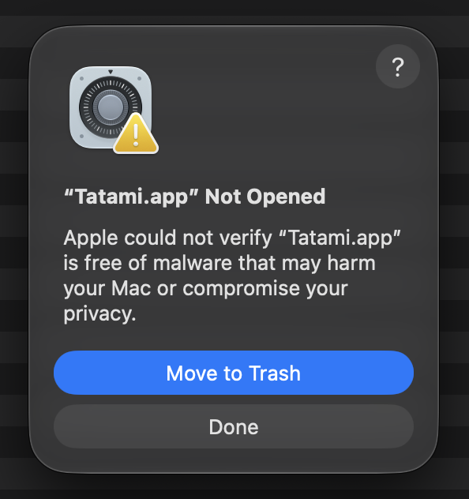

# Tatami

A free, open-source app for macOS and Windows that arranges windows on a grid, like [Divvy](https://mizage.com/divvy/). It lives in the menu bar on macOS and in the notification area of the taskbar on Windows.

Tatami is named after Japanese tatami mats, which are laid out on a grid to form a room.

## Features

- **Grid panel.** Open the grid from the Tatami icon or with a shortcut. Drag across the cells, and the current window moves to the area you selected. The grid size can be set from 1 × 1 to 10 × 10.
- **Snap to screen edges.** Drag a window to the top of the screen to maximize it, or to the left or right edge to fill that half. A preview shows where the window will go. It overlaps with the system's own tiling (macOS tiling, Windows Snap), so turn that off; see First launch for your platform.
- **Custom global shortcuts.** Choose an area on a small grid, give it a name, and record a key combination. Pressing it moves the current window to that area.
- **Function shortcuts.** Show the grid, or move the current window to the next screen while keeping its relative position.
- **Multiple displays.** A grid panel appears on every screen, and the window moves to the screen you select on.
- **10 languages.** English, 繁體中文, 简体中文, Français, Deutsch, Español, हिन्दी, 日本語, 한국어, العربية. The language is chosen inside the app.
- **Automatic updates** with [Sparkle](https://sparkle-project.org) on macOS and [NetSparkle](https://github.com/NetSparkleUpdater/NetSparkle) on Windows. Updates are verified with an EdDSA (Ed25519) signature before they are installed.
- **Settings backup.** Export your settings to a file and import them on another computer. A file exported on the other platform imports everything except key combinations, which you record again.
- **Launch at login.** On macOS Tatami is added to Login Items; on Windows it is added to your user's startup apps. The app has no Dock icon on macOS and no taskbar button on Windows.

## macOS

### Requirements

- macOS 14 Sonoma or later
- **Accessibility** permission, which Tatami needs to move other apps' windows

### Download

1. Download `Tatami-<version>.dmg` from [Releases](https://github.com/lenny-osp/tatami/releases).
2. Open the DMG and drag **Tatami** into **Applications**.

The DMG also includes **How to Open Tatami.txt**, which has the steps below in all 10 supported languages.

### Opening Tatami for the first time

Tatami is free and open source, but it is not notarized by Apple. The first time you open it, macOS blocks it with this message:



To allow it:

1. Click **Done**. Do not click **Move to Trash**.
2. Open **System Settings → Privacy & Security**.
3. Scroll down to **Security**. Next to the message saying Tatami was blocked, click **Open Anyway**, then enter your password.
4. Open Tatami again and click **Open Anyway**.

The **Open Anyway** button appears only for about an hour after macOS blocks the app. If you don't see it, open Tatami again to show the message again.

If you prefer Terminal, this one command replaces steps 1–4:

```bash
xattr -dr com.apple.quarantine /Applications/Tatami.app
```

You only need to do this once. Later versions update themselves: choose **Check for Updates…** from the menu bar icon, or leave automatic checks on in **Settings → General**. Updates keep your Accessibility permission.

### Build from source

You need the Xcode Command Line Tools. Install them with `xcode-select --install`. The full Xcode app is not needed.

```bash
git clone https://github.com/lenny-osp/tatami.git
cd tatami
./scripts/build-app.sh
open build/Tatami.app
```

To install it, copy `build/Tatami.app` to `/Applications`. To build a DMG, run `./scripts/make-dmg.sh` after building. An app you build yourself is not blocked by macOS.

### First launch

1. Tatami asks for **Accessibility** permission. Click **Open System Settings** and turn on Tatami in **Privacy & Security → Accessibility**.
2. Snap overlaps with macOS's own window tiling. To avoid conflicts, turn off tiling by dragging windows to screen edges in **System Settings → Desktop & Dock**.
3. Open **Settings…** from the menu bar icon to choose your language, grid size, and shortcuts. **Help** in the same menu explains each feature.

### Troubleshooting

- **Windows don't move even though Tatami is turned on in Accessibility.** macOS ties the permission to the app's code signature, so an entry left by a differently signed copy has no effect. Click the permission item in the Tatami menu: Tatami clears its old entry and adds itself again, and you only need to turn the switch on. Developers can create a self-signed code-signing certificate named `Tatami Dev` in Keychain Access; the build script then uses it, so the permission is kept across rebuilds.
- **A shortcut can't be recorded or does nothing.** Another tool, such as BetterTouchTool, Raycast, or Alfred, may already use the same key combination.
- **Tatami beeps when I press a shortcut or choose Show Grid.** There is no window to move. This happens when Tatami's own Settings or Help window is in front, or when the frontmost app has no open window.
- **The update dialog is in a different language.** Update dialogs come from Sparkle and follow the macOS system language, not the language chosen in Tatami.

### Uninstall

1. Choose **Quit Tatami** from the menu bar icon.
2. Delete `Tatami.app` from **Applications**.
3. Optional: remove its permission and settings.

```bash
tccutil reset Accessibility local.tatami.app
defaults delete local.tatami.app
```

If you turned on **Launch at Login**, turn it off in Tatami before deleting the app, or remove Tatami in **System Settings → General → Login Items**.

## Windows

### Requirements

- Windows 10 version 1809 or later, or Windows 11
- A 64-bit (x64) PC. The .NET runtime is included, so nothing else needs to be installed.
- No special permission. Tatami can move any window except those of apps running as administrator (see Troubleshooting).

### Download

1. Download `Tatami-<version>-Setup.exe` from [Releases](https://github.com/lenny-osp/tatami/releases).
2. Run it. Tatami installs for your user account only, in `%LocalAppData%\Programs\Tatami`, so it doesn't need administrator rights. It adds Tatami to the Start menu and can start it when setup finishes.

Each release also has `Tatami-<version>-Setup.exe.sha256`. To check the download, run `Get-FileHash Tatami-<version>-Setup.exe` in PowerShell and compare the hash with the one in that file.

### Opening Tatami for the first time

Tatami is free and open source, but the installer is not code-signed. The first time you run it, Microsoft Defender SmartScreen shows **Windows protected your PC**. To allow it:

1. Click **More info**.
2. Check that the app name is `Tatami-<version>-Setup.exe`, then click **Run anyway**.

Your browser may also warn that the file isn't commonly downloaded. In Microsoft Edge, open the downloads list, choose **…** next to the file, then **Keep**.

You only need to do this once. Later versions update themselves: choose **Check for Updates…** from the Tatami icon, or leave automatic checks on in **Settings → General**. An update downloads the new installer, verifies its signature, installs it without asking again, and restarts Tatami.

### Build from source

You need the [.NET 10 SDK](https://dotnet.microsoft.com/download) and PowerShell 7. Visual Studio is not needed.

```powershell
git clone https://github.com/lenny-osp/tatami.git
cd tatami
pwsh scripts/build-windows.ps1
.\build\windows\publish\Tatami.exe
```

If [Inno Setup 6](https://jrsoftware.org/isinfo.php) is installed, the script also builds the installer `build\windows\Tatami-<version>-Setup.exe`. An app you build yourself is not blocked by SmartScreen.

### First launch

1. Tatami appears as an icon in the notification area of the taskbar. If you don't see it, click the **^** arrow next to the clock; you can drag the icon onto the taskbar to keep it visible.
2. Snap overlaps with Windows Snap. To avoid conflicts, turn off **Snap windows** in **Settings → System → Multitasking**.
3. Open **Settings…** from the Tatami icon to choose your language, grid size, and shortcuts. **Help** in the same menu explains each feature.

### Troubleshooting

- **Some windows don't move.** Windows doesn't let an app move the windows of apps running as administrator, such as an elevated Terminal or Task Manager. Tatami beeps instead. Run Tatami as administrator if you need to arrange those windows too.
- **A shortcut can't be recorded or does nothing.** Another tool, such as PowerToys (Keyboard Manager or FancyZones) or AutoHotkey, or Windows itself, may already use the same key combination. Most `Win` + letter combinations are reserved by Windows.
- **Tatami beeps when I press a shortcut or choose Show Grid.** There is no window to move. This happens when Tatami's own Settings or Help window is in front, when the desktop or taskbar is focused, or when the window belongs to an app running as administrator.

### Uninstall

1. Choose **Quit Tatami** from the Tatami icon.
2. Open **Settings → Apps → Installed apps** (on Windows 10, **Apps & features**), choose **…** next to Tatami, then **Uninstall**. This also removes the Launch at Login entry and the updater's state in the registry.
3. Optional: delete your settings, which are in `%AppData%\Tatami`.

If you deleted the program folder by hand instead, remove the Launch at Login entry and the updater's state in PowerShell:

```powershell
Remove-ItemProperty -Path HKCU:\Software\Microsoft\Windows\CurrentVersion\Run -Name Tatami
Remove-Item -Path HKCU:\Software\Tatami -Recurse
```

## Privacy

Tatami doesn't collect or send any personal data. It only reads and changes window positions; on macOS it uses Accessibility permission for that. Its only network connection is the update check, which downloads `appcast.xml` (macOS) or `appcast-windows.xml` and its signature (Windows) from this repository's GitHub Releases. You can turn off automatic checks in **Settings → General**.

## Contributing

Issues and pull requests are welcome. Please read [AGENTS.md](AGENTS.md) for the project layout, conventions, localization rules, and release process. Every user-visible string must be translated into all supported languages; both apps share the same translation files in `Resources/`.

Before opening a pull request, run the checks for the platform you changed:

- macOS: `swift test` and `./scripts/check-localizations.sh`
- Windows: `dotnet test Windows/Tatami.sln` and `python scripts/check_localizations.py`

The localization check is the same on both platforms and needs only Python 3. CI runs the checks, the tests, and a full build for both platforms on every pull request.

## Support

If Tatami is useful to you, you can support its development:

<a href="https://www.buymeacoffee.com/chihlingw"></a>

## License

[MIT](LICENSE) © 2026 Chihling Wang

Tatami uses [Sparkle](https://sparkle-project.org) on macOS and [NetSparkle](https://github.com/NetSparkleUpdater/NetSparkle) on Windows for updates, both under the MIT License. See [THIRD_PARTY_NOTICES.md](THIRD_PARTY_NOTICES.md).
